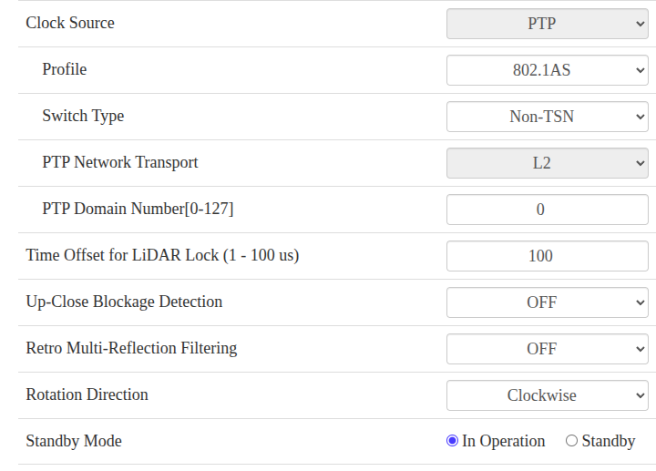

# Hesai Configuration
## PTP Configuration
Based on the PTP services in `services/lidar_ptp` the correct configuration for PTP lidar side is the following:

  - Profile: 802.1AS
  - Switch Type: Non-TSN
  - PTP Domain Number: 0
  - Time Offset for LiDAR Lock: 100 (ns)

The switch type configuration depends on the actual wiring connecting LiDAR to host:

  - LiDAR directly connected to host: TSN
  - LiDAR NOT directly connected to host (e.g. a switch is in the way): Non-TSN

The following image depicts the correct configuration as per Hesai Web UI:
